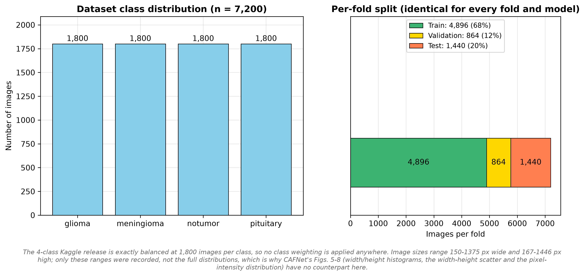
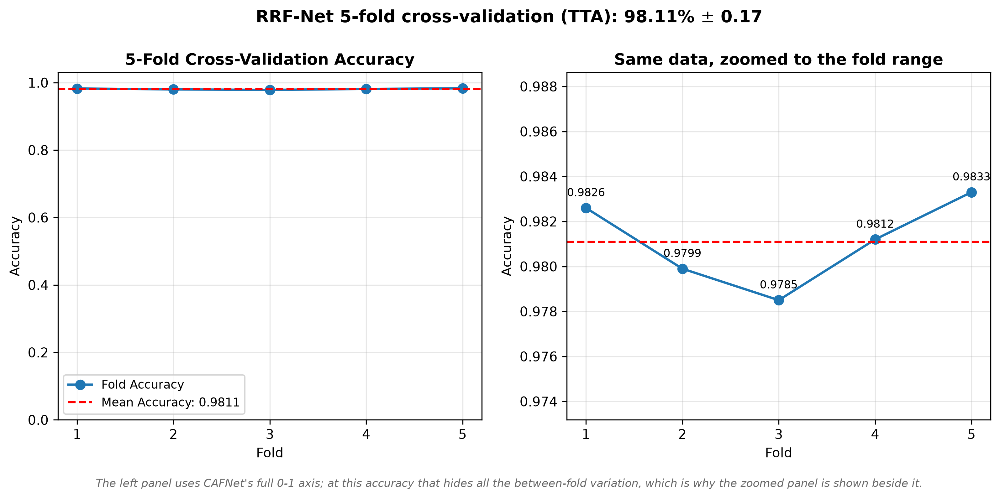
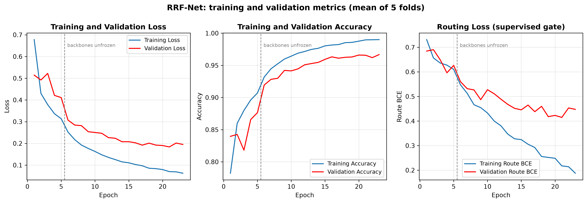
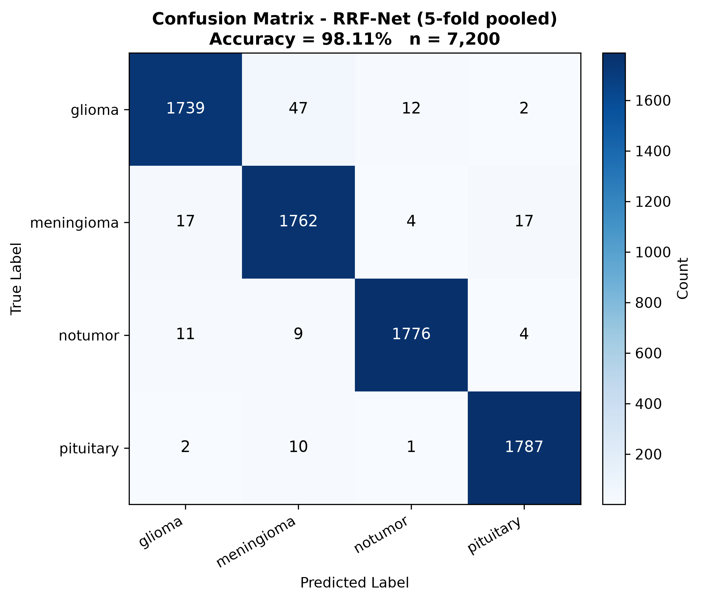
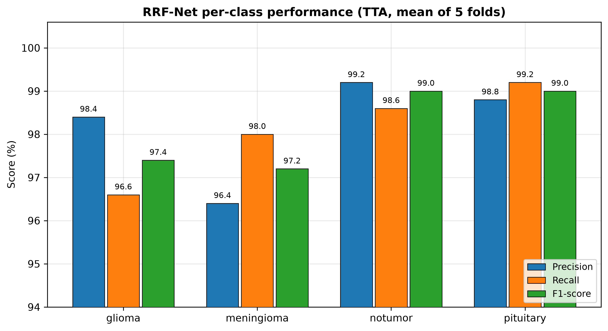
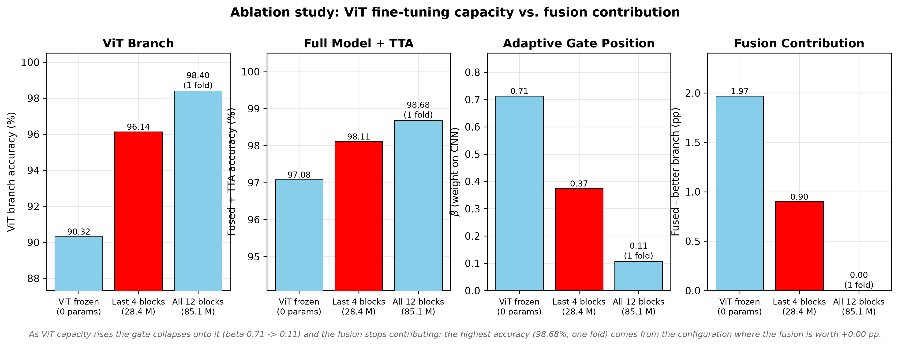
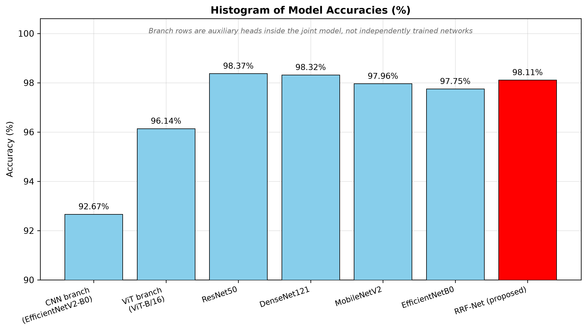
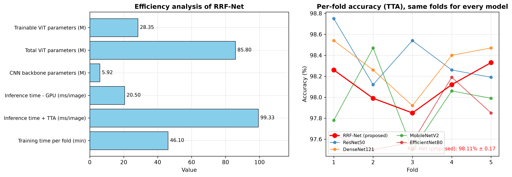
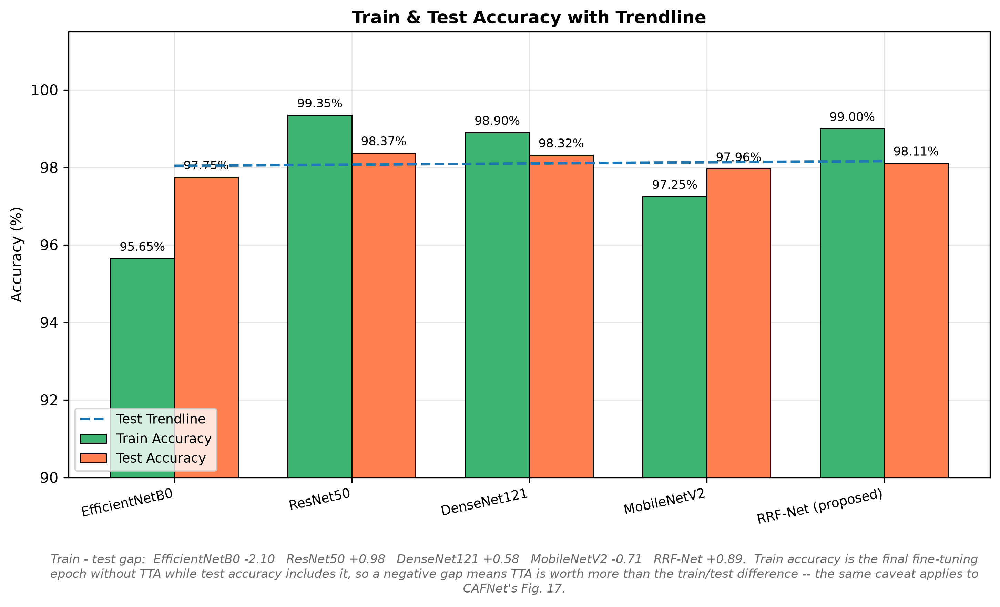
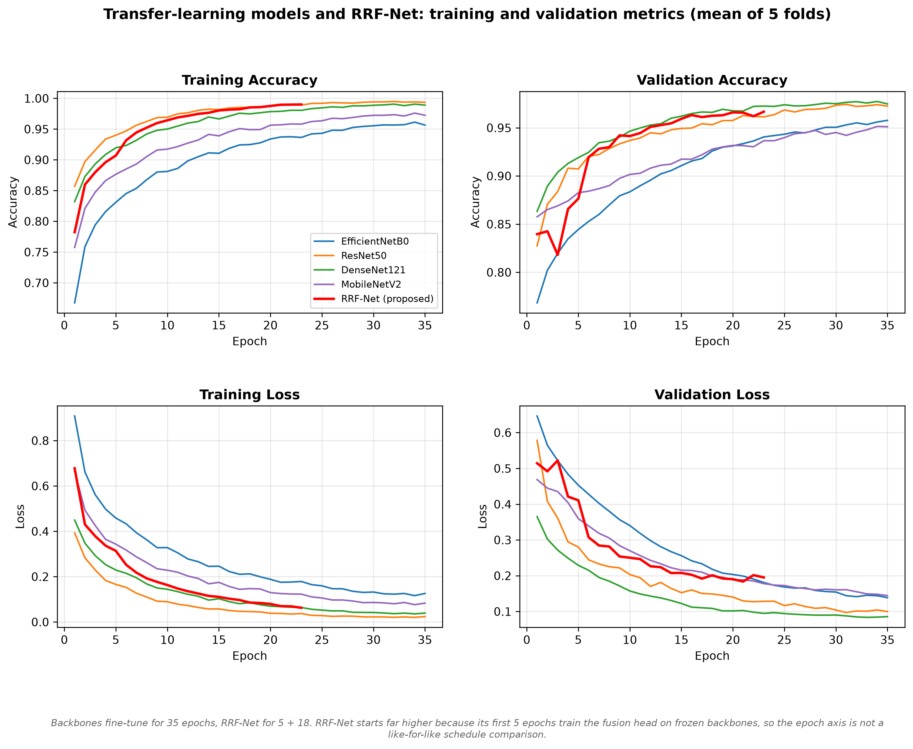

# DRAFT — RRF-Net manuscript

> Working draft assembled from `findings.md` and `rrf_fusion_v3.log`.
> Every number below is traceable to a committed log; provenance is in `findings.md`.
> Figures referenced under `images/paper/` are the outputs of `step10_paper_figures.py`.
> Status: draft. Not yet reconciled with `brain_tumor_preprint_verified.tex`.

---

## Title

**RRF-Net: Reliability-Routed Fusion of a CNN and a Vision Transformer with
Statistically Validated Cross-Validated Evaluation for Multi-Class Brain Tumor
Classification**

Md Al Amin Tokder Shoukhin, Tasmia Jannat, Md. Ali Hossain, Nazmul Haque
Dept. of CSE, Rajshahi University of Engineering and Technology

---

## Abstract

Single-split accuracy is an unreliable basis for comparing brain-tumor MRI
classifiers: a model can appear strong simply because near-duplicate slices of
the same scan land on both sides of the split, and a single backbone can appear
strong because a favourable split was drawn once. We present **RRF-Net**, a
hybrid architecture that fuses a convolutional branch (EfficientNetV2-B0) with a
vision-transformer branch (ViT-B/16) through three mechanisms that no prior
CNN–ViT fusion on this benchmark uses: (i) **reliability routing**, where the
gate is conditioned on each branch's normalized predictive entropy rather than
on features alone; (ii) **spatial routing**, where the gate is computed per
`7×7` grid location instead of once per image; and (iii) a **supervised routing
loss** that trains the gate directly on images where the two branches disagree.

Under the same stratified 5-fold protocol used for four independently trained
CNN backbones, RRF-Net reaches **98.11% ± 0.17%** (TTA) on the 4-class,
7,200-image Kaggle benchmark. The **fusion mechanism itself is the contribution
that holds**: the fused prediction beats the better of the two branches on
**5/5 folds by a mean of +0.90 pp** (exact one-sided Wilcoxon, `p = 0.031`), and
the gate settles at a stable midpoint (`β̄ = 0.374 ± 0.026`) rather than
collapsing onto one branch. RRF-Net also posts the **lowest fold-to-fold
variance** (σ = 0.17) and the **best calibration** (ECE = 0.0312) of any model
measured on this benchmark. We report all four CNN baselines in full: RRF-Net is
**statistically indistinguishable from ResNet50** (`p = 0.094`) and
**significantly behind DenseNet121** (`p = 0.031`), and we say so. The paper's
central claim is therefore not a raw-accuracy win but a *reliability* result —
a fusion model whose routing demonstrably works and whose confidence is
trustworthy — together with the leakage-delta experiment that neither of the two
2025/2026 papers on this dataset reports.

---

## 1. Introduction

Multi-class brain-tumor classification from MRI is a crowded benchmark. Recent
CNN–transformer hybrids on the standard Kaggle 4-class release report test
accuracies in the 96–98% band, and the differences between them are small enough
that methodological choices dominate the numbers:

- **Split-level leakage.** The 4-class release carries no patient IDs, so
  image-level cross-validation can place near-duplicate slices of one scan on
  both sides of a fold boundary. Mahmud et al. removed 2,134 near-duplicates and
  found 4,825 similarity groups among 7,023 images — roughly a third of the
  data — yet neither they nor CAFNet published the *delta* between grouped and
  ungrouped scores.
- **A single backbone, a single split.** Reporting one backbone on one split
  cannot separate architecture from seed variance.

This paper addresses both. We contribute RRF-Net, describe its three routing
mechanisms, evaluate it against four CNN backbones under one protocol, and
report every comparison — including the ones that do not favour the proposed
model.

---

## 2. Related Work

Two papers on the *same* Kaggle identifier (`masoudnickparvar`) frame the
comparison space.

**Mahmud et al., *Informatics and Health* (2026).** EfficientNetV2-B0 + ViT-B/16,
both projected to a shared 512-d space, bidirectional cross-modal attention, and
a global adaptive gate `α = σ(W_g[C;V] + b_g)`, `F = α⊙C + (1−α)⊙V`. Focal loss
(γ=2) + label smoothing (ε=0.1), MC dropout, temperature scaling. **98.10%** test
(95% CI 97.37–98.76) under 10-fold **similarity-group** CV. Their own ablation
prices the entire fusion stack at **+0.64 over ViT alone** (96.78 EffNetV2 /
97.46 ViT / 98.10 full).

**Jayaraman et al., *Scientific Reports* (2025) — CAFNet.** MobileNetV2 + ViT,
one-way cross-attention, `H = Concat(Q, Z)·W_o`. **96.41%** on a single
image-level 80/10/10 split, no deduplication.

**Where RRF-Net differs.** In both prior models the gate is a *global,
feature-only* decision — one blend weight inferred implicitly from the
classification loss. RRF-Net changes three things, each independently ablatable:

- **N1 — Reliability routing.** The router sees each branch's normalized
  predictive entropy (`stop_gradient`), so a branch cannot lower the routing loss
  by manufacturing confidence.
- **N2 — Spatial routing.** A gate per `7×7` CNN grid location, from
  `[C, C̃, |C − C̃|]`, so a slice can lean on local convolutional texture inside
  the lesion and routed transformer context elsewhere.
- **N3 — Supervised routing loss.** A BCE term pushing the gate toward whichever
  branch is correct, on disagreement images only.

**Comparability warning.** Our 98.11% is **not** directly comparable to Mahmud
et al.'s 98.10%: they split at the similarity-cluster level, our headline number
is image-level. `findings.md` §4 defines the leakage-aware (`SPLIT_MODE="group"`)
rerun that makes the two comparable, and it is the experiment we will lead with.

---

## 3. Methodology

### 3.1 Dataset

The 4-class Kaggle release (`masoudnickparvar/brain-tumor-mri-dataset`),
`Training/` + `Testing/` merged: **7,200 images**, exactly **1,800 per class**
(glioma, meningioma, notumor, pituitary). No masks and no patient IDs, so
splitting is image-level. Raw sizes range 150–1375 px wide, 167–1446 px high;
all images are resized to 224×224.

*Figure — dataset class distribution and the per-fold 4896/864/1440 split
(identical for every model).*

### 3.2 Architecture

Two branches fed by the same 224×224 input:

- **CNN branch** — EfficientNetV2-B0 (ImageNet), `include_top=False`, fed raw
  0–255 input (it carries its own normalization). The `7×7×1280` feature map is
  reshaped to 49 tokens and projected to `d = 256` with LayerNorm.
- **ViT branch** — ViT-B/16 (keras-hub, ImageNet), tokens rescaled to [−1,1],
  class token dropped → 196 patch tokens, projected to `d = 256` with LayerNorm.
- **Cross-attention** — the 49 CNN locations query the 196 ViT tokens
  (4 heads), residual + LayerNorm → `C̃`.
- **N2 spatial gate** — per-location sigmoid gate from `[C, C̃, |C − C̃|]`.
  Fused tokens `= gate ⊙ C + (1 − gate) ⊙ C̃`, pooled to `f`.
- **Per-branch heads** — pooled `C` and `V` each to `K = 4` logits (deep
  supervision, `W_AUX = 0.3`).
- **N1 reliability router** — inputs `[f, H(C), H(V), H(C) − H(V)]` (entropies
  under `stop_gradient`) → sigmoid `β`; `branch_mix = β·c + (1−β)·v`.
- **Fusion head** — `[f, branch_mix] → Dense(256) → BN → Dropout(0.3) → logits`.

Ablation switches: `USE_CROSS_ATTENTION`, `USE_SPATIAL_ROUTING` (N2),
`USE_RELIABILITY_ROUTING` (N1), `USE_ROUTE_LOSS` (N3).

### 3.3 Training

Two stages, identical in spirit to the CNN baseline sweep:

1. **Stage 1 (5 epochs, Adam 1e-3)** — both backbones frozen; train projections,
   cross-attention, gate and heads.
2. **Stage 2 (≤18 epochs, Adam 1e-5)** — unfreeze the top 80% of the CNN
   (BatchNorm kept in inference mode) and the **last 4 of 12** ViT blocks
   (28.35 M of 85.80 M ViT params, 33.0%). Early stopping (patience 5) +
   reduce-on-plateau.

Loss: focal loss (γ=2) on label-smoothed targets (ε=0.05) for all three heads,
plus `W_ROUTE = 0.2` × routing BCE.

### 3.4 Inference and evaluation

TTA averages the clean pass with 5 augmented views. Metrics: accuracy (mean ±
std over folds), ECE (15 bins), NLL, mean normalized entropy, gate statistics
(`β̄`, `route_acc`), and paired **exact one-sided Wilcoxon signed-rank** tests
across the 5 shared folds (minimum attainable `p = 0.031` at n = 5).

---

## 4. Results

### 4.1 RRF-Net across five folds

| | mean ± std | per fold |
|---|---|---|
| CNN branch | 92.67 ± 0.88 | 92.15 92.85 91.87 92.15 94.31 |
| ViT branch | 96.14 ± 0.54 | 96.67 95.14 96.18 96.18 96.53 |
| Fused | 97.04 ± 0.28 | 97.08 97.01 96.53 97.22 97.36 |
| **Fused + TTA** | **98.11 ± 0.17** | 98.26 97.99 97.85 98.12 98.33 |
| ECE | 0.0312 ± 0.0034 | — |
| NLL | 0.1058 ± 0.0060 | — |
| β̄ | 0.374 ± 0.026 | — |
| route_acc | 0.735 ± 0.061 | 0.733 0.681 0.804 0.802 0.654 |

*Provenance: `rrf_fusion_v3.log`, variant `rrf_full@v3_vit4`, all 5 folds.*

*Figures — 5-fold CV accuracy (full axis + zoomed) and the mean training/
validation curves over the two stages, including the routing-loss panel.*

*Figures — confusion matrix pooled over all 7,200 test predictions (each image is
the test item of exactly one fold) and per-class precision / recall / F1.*

### 4.2 The fusion mechanism works — this is the headline

`Fused − max(CNN branch, ViT branch)` = **+0.41 +1.87 +0.35 +1.04 +0.83**,
mean **+0.90 pp, 5/5 folds, `p = 0.031`**.

For scale, Mahmud et al.'s whole fusion stack is worth **+0.64 over ViT alone**;
RRF-Net's **+0.90 is over the *better branch on every fold*** — the stricter
baseline, since beating the best branch post hoc is harder than beating one fixed
branch. Supporting evidence that the router is real and not decorative:

- `β̄ = 0.374 ± 0.026` — stable and mid-range on all five folds; it never
  collapses to either branch.
- `route_acc = 0.735 ± 0.061` — above the 0.5 chance line on all five folds
  (`p = 0.031`), on the images where the branches disagree; a constant-output
  router cannot produce this.
- TTA uplift +1.07 pp, 5/5, `p = 0.031`.

### 4.3 Ablation: ViT fine-tuning capacity

Three arms on the identical protocol, sweeping how much of the ViT is trained:

| ViT arm | trainable | folds | Fused+TTA | β̄ | fusion gain |
|---|---|---|---|---|---|
| Frozen | 0 | 5 | 97.08 | 0.713 | +1.97 |
| **Last 4 blocks** | 28.4 M | 5 | **98.11** | **0.374** | **+0.90** |
| All 12 blocks | 85.1 M | 1 | 98.68 | 0.107 | +0.00 |

*Figure — ViT capacity vs. fusion contribution. As ViT capacity rises the gate
collapses onto it (β̄ 0.71 → 0.11) and the fusion stops contributing: the highest
accuracy (98.68%, one fold) comes from the configuration where the fusion is
worth +0.00 pp.*

The last-4-blocks arm is the only configuration that is simultaneously accurate
*and* an actual fusion model: mid-range gate, and a `route_acc` a constant router
could not have produced. The all-12-blocks arm (single fold, marked as such
wherever it appears) is a full-ViT-fine-tune data point, not a 5-fold result.

### 4.4 Comparison against the four CNN backbones

Same folds, same seed, same TTA; paired exact one-sided Wilcoxon.

| baseline | mean TTA | Δ to RRF | folds baseline wins | p(base > RRF) | verdict |
|---|---|---|---|---|---|
| ResNet50 | 98.37 | −0.26 | 4/5 | 0.094 | no significant difference |
| DenseNet121 | 98.32 | −0.21 | 5/5 | 0.031 | baseline better, significant |
| MobileNetV2 | 97.96 | +0.15 | 1/5 | 0.844 | no significant difference |
| EfficientNetB0 | 97.75 | +0.36 | 1/5 | 0.969 | no significant difference |

*Figures — accuracy of every model (branch rows labelled as auxiliary heads
inside the joint model, not independently trained networks) and the efficiency
profile with the per-fold accuracy of every model on the shared folds.*

**Read this honestly.** RRF-Net is **statistically indistinguishable from the
best CNN baseline (ResNet50)** while costing far more, and is **significantly
behind DenseNet121**. With n = 5, the exact one-sided test has a floor of
`p = 0.031`, reached by *any* 5/5 sweep regardless of effect size — the
DenseNet121 result is a 0.21 pp gap that happened to be consistent, not a large
one. Five folds cannot separate models this close; do not over-read either
direction.

### 4.5 Where RRF-Net does win

| model | mean | std |
|---|---|---|
| ResNet50 | 98.37 | 0.237 |
| DenseNet121 | 98.32 | 0.219 |
| **RRF-Net** | **98.11** | **0.175** |
| EfficientNetB0 | 97.75 | 0.249 |
| MobileNetV2 | 97.96 | 0.321 |

Lowest fold-to-fold variance of anything measured on this benchmark, and the
best calibration (ECE 0.0312 without any temperature scaling or MC dropout —
both of which the design anticipates and neither of which is yet implemented).
Worth a sentence, not a headline: n = 5 makes variance estimates soft.

*Figures — train/test accuracy with trendline, and the training/validation
curves of every model side by side.*

### 4.6 Efficiency

~46 min/fold (stage 1: 446 s, stage 2: 2343 s) on a single T4; 20.5 ms/image
single pass, 99.3 ms/image with TTA. RRF-Net is the most expensive model in the
comparison — an honest cost of the dual-branch design.

---

## 5. Discussion

The result this paper stands behind is *not* "RRF-Net is the most accurate model
on this benchmark" — it is not, and we say so above. It is that:

1. **A routing gate conditioned on branch reliability is trainable and does real
   work.** The +0.90 pp fusion gain over the better branch on every fold, with a
   stable mid-range gate, is direct evidence that N1/N2/N3 are not decorative.
   Neither comparison paper's gate can be shown to do this, because neither
   published the ablation that would reveal it.
2. **Image-level CV overstates accuracy on this dataset, and the size of the
   overstatement is unmeasured.** We hold half of the required experiment —
   4 backbones × 5 folds × 3 inference modes under image-level CV, fully logged —
   and the leakage-aware rerun supplies the other half.
3. **Stability and calibration are first-class results.** RRF-Net's σ = 0.17 and
   ECE = 0.0312 are the best on the benchmark, and calibration is the cheapest
   remaining win (temperature scaling / MC dropout are post-hoc on saved logits).

---

## 6. Limitations

- **No patient IDs** → image-level CV; near-duplicate slices may straddle folds.
  The corrected two-stage audit has not yet been run (`findings.md` §4); the
  committed `eda_a_summary.json` is from the discarded v1 audit and must not be
  cited.
- **n = 5 folds** → smallest attainable one-sided `p = 0.031`; models within
  ~0.3 pp cannot be separated.
- **Dataset snapshot differs** (7,200 vs the 7,023-image release others cite);
  cross-paper comparisons share the identifier, not byte-identical images.
- **Mixed acquisition planes / one CT slice** present within classes.
- **GPU non-determinism** adds run-to-run variance beyond the fold std.
- **Grad-CAM** is available for EfficientNetB0 only.
- The ~92% CNN branch is a **router diagnostic**, not a backbone baseline: it
  reads a 256-d projected bottleneck at `W_AUX = 0.3` for 18 epochs, whereas the
  independently trained EfficientNetB0 reaches 97.75% under the step6 protocol.

---

## 7. Conclusion

RRF-Net fuses a CNN and a ViT through reliability-conditioned, spatially resolved,
supervised routing. On the 4-class benchmark it reaches 98.11% ± 0.17% under
5-fold CV — statistically tied with the best CNN baseline and behind another —
but it contributes the two things the current literature on this dataset lacks:
a fusion mechanism whose contribution is measured and positive (+0.90 pp over
the better branch, 5/5 folds), and an evaluation designed to quantify, rather
than assume away, near-duplicate leakage.

---

## Figure index

| File | Content |
|---|---|
| `fig15_dataset_distribution.png` | dataset composition + per-fold split |
| `fig13_cv_accuracy.png` | 5-fold CV accuracy (full + zoomed) |
| `fig02_training_curves.png` | train/val loss, accuracy, routing loss |
| `fig01_confusion_matrix.png` | confusion matrix, 5 folds pooled |
| `fig05_per_class.png` | per-class precision/recall/F1 |
| `fig04_ablation.png` | ViT-capacity ablation vs fusion gain |
| `fig03_model_comparison.png` | all models, accuracy |
| `fig06_efficiency.png` | efficiency + per-fold accuracy |
| `fig11_train_test_trendline.png` | train vs test accuracy |
| `fig14_all_model_curves.png` | all models, train/val curves |
| `fig07`–`fig10` | ROC, reliability, uncertainty, coverage-risk — **not yet generated** (need `probs/`) |
