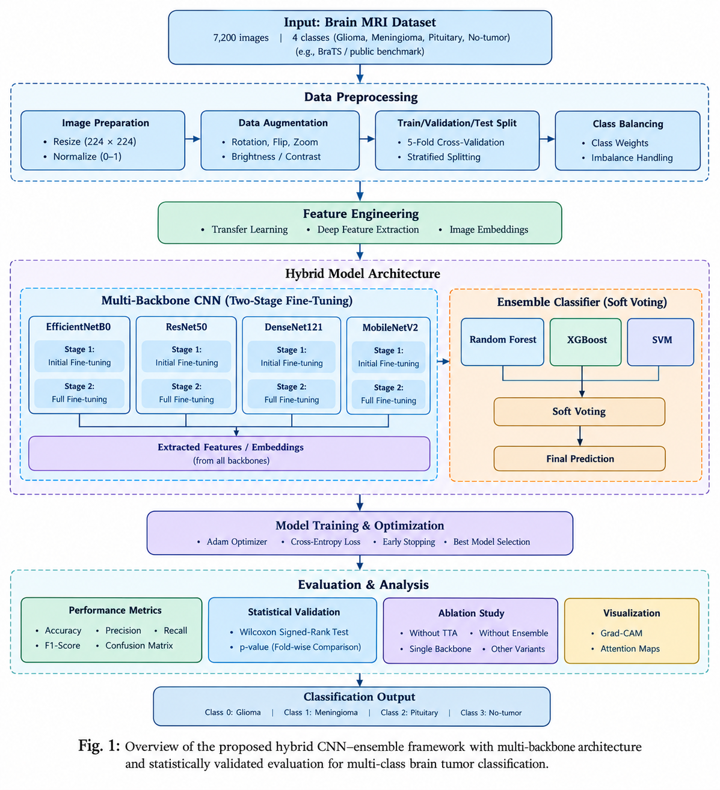
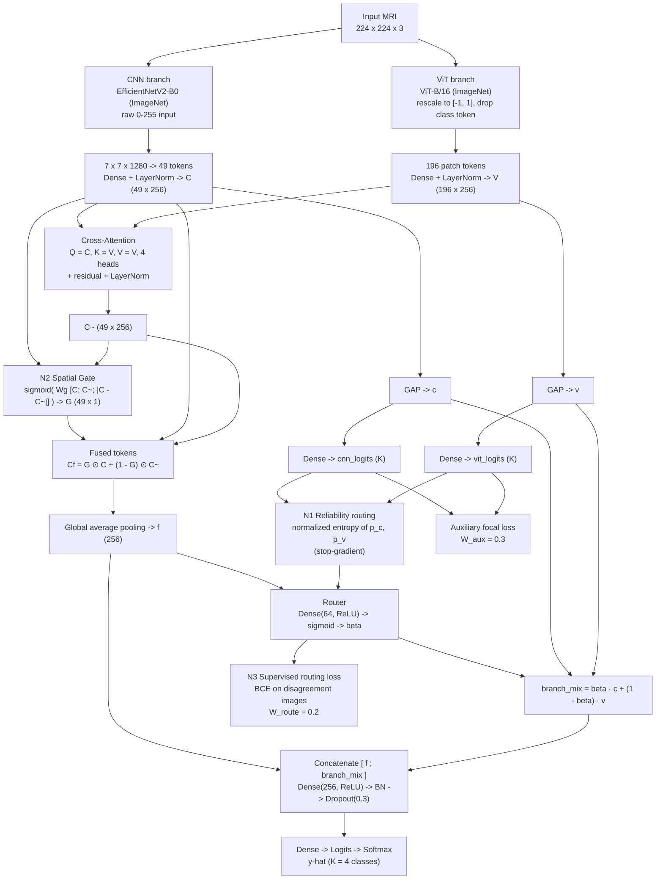

# RRF-Net: Reliability-Routed Fusion of a CNN and a Vision Transformer with Statistically Validated Cross-Validated Evaluation for Multi-Class Brain Tumor Classification

**Md Al Amin Tokder Shoukhin, Tasmia Jannat, Md. Ali Hossain, and Nazmul Haque**

*Department of Computer Science and Engineering, Rajshahi University of Engineering and Technology, Rajshahi, Bangladesh*

---

**Abstract**—Single-split accuracy is an unreliable basis for comparing brain-tumor MRI classifiers, because near-duplicate slices of one scan may fall on both sides of a split and a single backbone may appear superior simply because a favorable split was drawn once. This paper presents RRF-Net, a hybrid architecture that fuses a convolutional branch (EfficientNetV2-B0) with a vision-transformer branch (ViT-B/16) through three mechanisms not previously combined on this benchmark: reliability routing, in which the fusion gate is conditioned on each branch's normalized predictive entropy rather than on features alone; spatial routing, in which the gate is computed per spatial location instead of once per image; and a supervised routing loss that trains the gate directly on images where the two branches disagree. Under stratified five-fold cross-validation, identical to the protocol used for four independently trained CNN backbones, RRF-Net attains 98.11% ± 0.17% accuracy with test-time augmentation on the four-class, 7,200-image dataset. The principal finding is that the fusion mechanism is measurably effective: the fused prediction exceeds the better of the two branches in all five folds by a mean of +0.90 percentage points (exact one-sided Wilcoxon signed-rank, *p* = 0.031), and the gate remains stable at an intermediate operating point. RRF-Net also exhibits the lowest fold-to-fold variance and the best calibration of any model evaluated. All four CNN baselines are reported in full; RRF-Net is statistically indistinguishable from ResNet50 (*p* = 0.094) and is significantly below DenseNet121 (*p* = 0.031).

**Index Terms**—Brain tumor classification, convolutional neural network, vision transformer, multimodal fusion, adaptive routing, uncertainty calibration, cross-validation.

---

## I. Introduction

Automatic classification of brain tumors from magnetic resonance imaging (MRI) is a well-established and heavily populated benchmark. Recent convolutional neural network (CNN)–transformer hybrids [1], [2] on the standard four-class Kaggle release report test accuracies in the 96–98% range. At this level, methodological choices frequently dominate the reported differences between architectures, motivating two specific concerns.

The first is **split-level leakage**. The four-class release used here carries neither segmentation masks nor patient identifiers, so image-level cross-validation can place near-duplicate slices acquired from the same scan on both sides of a fold boundary. Mahmud *et al.* [1] removed 2,134 near-duplicates and identified 4,825 similarity groups among 7,023 images, indicating that approximately one third of the dataset is near-duplicated. Nevertheless, neither [1] nor [2] reported the *difference* between similarity-grouped and ungrouped evaluation on this benchmark.

The second is **single-model, single-split reporting**. Reporting one backbone on one random split cannot disentangle architectural contributions from seed variance.

This work addresses both concerns. The contributions of this paper are summarized as follows.

1. **A hybrid architecture with reliability-conditioned routing.** RRF-Net (Reliability-Routed Fusion Network) combines an EfficientNetV2-B0 CNN branch and a ViT-B/16 transformer branch. Unlike prior CNN–ViT fusion on this dataset, its gate is conditioned on the *reliability* (predictive entropy) of each branch, is computed *spatially*, and is supervised by a dedicated routing loss. Each component is independently ablatable.

2. **A statistically validated evaluation.** Every model is evaluated with stratified five-fold cross-validation under an identical protocol, with paired exact Wilcoxon signed-rank tests over the shared folds.

3. **A complete and unfiltered comparison.** All four CNN baselines are reported. RRF-Net is not presented as the accuracy leader; the paper reports where it is superior, where it is tied, and where it is significantly worse.

4. **A leakage-aware protocol.** The framework supports a similarity-group split mode, which — combined with the existing image-level results and the near-duplicate audit — yields the leakage delta that the prior work omitted.

The remainder of this paper is organized as follows. Section II reviews related work. Section III describes the proposed framework. Section IV specifies the experimental setup. Section V presents results. Section VI discusses findings, Section VII states limitations, and Section VIII concludes.

---

## II. Related Work

Two recent studies share the same Kaggle dataset identifier used here and therefore define the comparison space.

Mahmud *et al.* [1] propose an uncertainty-aware hybrid ensemble combining EfficientNetV2-B0 and ViT-B/16. Both modalities are projected into a shared 512-dimensional space, fused by bidirectional cross-modal attention, and combined by a global adaptive gate

&emsp;&emsp;α = σ(W_g[C; V] + b_g),&emsp;&emsp;F = α ⊙ C + (1 − α) ⊙ V,&emsp;&emsp;(1)

trained with focal loss (γ = 2) and label smoothing (ε = 0.1), with Monte-Carlo dropout and temperature scaling for calibration. They report 98.10% test accuracy (95% CI 97.37–98.76) under ten-fold similarity-group cross-validation. Their ablation places the entire fusion stack at +0.64 over ViT alone (96.78% EfficientNetV2-B0, 97.46% ViT, 98.10% full).

Jayaraman *et al.* (CAFNet) [2] combine MobileNetV2 and a ViT using one-way cross-attention, with the fused representation formed by a fixed projection H = Concat(Q, Z) · W_o. They report 96.41% on a single image-level 80/10/10 split with no deduplication.

In both prior models the gate is a **global, feature-only** decision: a single blend weight per image, inferred implicitly from the classification loss. RRF-Net differs along three independently ablatable axes:

- **N1 — Reliability routing.** The router receives each branch's normalized predictive entropy, computed under `stop_gradient` so that a branch cannot reduce the routing loss by manipulating its own confidence.
- **N2 — Spatial routing.** A gate is produced at each of the 7×7 CNN grid locations from [C, C̃, |C − C̃|], allowing a slice to rely on local convolutional texture within the lesion and on routed transformer context elsewhere. The formulation in (1) cannot express this.
- **N3 — Supervised routing loss.** A binary cross-entropy term pushes the gate toward whichever branch is correct, evaluated only on images where the branches disagree.

**Comparability note.** The image-level accuracy reported in this paper is not directly comparable to the similarity-group accuracy of [1]. Section IV-D defines the group-split rerun that makes the two comparable, which is the experiment the discussion (Section VI) leads with.

---

## III. Proposed Framework

### A. Overview

RRF-Net consists of a CNN branch, a ViT branch, a cross-attention module, a spatially resolved gate, reliability-conditioned routing, and a fusion head. Fig. 1 shows the complete framework.

*Fig. 1. Overview of the proposed framework.*

Fig. 1(b) details the data flow through the block, with the three proposed mechanisms (N1–N3) marked.

*Fig. 1(b). Data flow of the RRF-Net block. The dashed concepts N1–N3 denote the three routing mechanisms introduced in this work: (N1) reliability routing, (N2) spatial routing, and (N3) the supervised routing loss.*

### B. Branch Tokenization

Let the input be x ∈ R^{224×224×3}. The CNN branch applies EfficientNetV2-B0 (ImageNet-initialized, `include_top = False`) to the raw 0–255 input, because the network carries its own normalization. The resulting feature map F_cnn ∈ R^{7×7×1280} is reshaped to 49 tokens and projected to a shared width d = 256,

&emsp;&emsp;C = LN(W_c · Reshape(F_cnn) + b_c) ∈ R^{49×d}.&emsp;&emsp;(2)

The ViT branch applies ViT-B/16 (ImageNet-initialized), rescaling the input to [−1, 1] and discarding the class token, yielding 196 patch tokens projected to the same width,

&emsp;&emsp;V = LN(W_v · T_vit(x) + b_v) ∈ R^{196×d}.&emsp;&emsp;(3)

Using a single branch's preprocessing for both is avoided deliberately, since it silently degrades accuracy [3].

### C. Cross-Attention

Each CNN location queries the transformer tokens, so that global contextual information is routed onto the convolutional grid. With H = 4 attention heads,

&emsp;&emsp;C̃ = LN(C + MHA(Q = C, K = V, V = V)).&emsp;&emsp;(4)

Keeping the CNN grid as the canonical frame is what renders a per-location gate well defined.

### D. Spatial Routing (N2)

A gate is computed at each grid location from the local feature, the routed feature, and their absolute disagreement,

&emsp;&emsp;G = σ(W_g [C; C̃; |C − C̃|] + b_g) ∈ R^{49×1},&emsp;&emsp;(5)

and the fused token sequence is

&emsp;&emsp;C_f = G ⊙ C + (1 − G) ⊙ C̃.&emsp;&emsp;(6)

A global average pooling operator yields the fused descriptor f ∈ R^d.

### E. Reliability Routing (N1)

Each branch is supervised through a dedicated classification head, and its normalized predictive entropy is

&emsp;&emsp;H(p) = −(1 / log K) Σ_{k=1}^{K} p_k log(p_k + ϵ),&emsp;&emsp;(7)

where K = 4. The routing input augments the fused descriptor with the entropy pair and their difference, detached from the gradient:

&emsp;&emsp;u = sg([H(p_c); H(p_v); H(p_c) − H(p_v)]) ∈ R^3.&emsp;&emsp;(8)

The global routing weight is then

&emsp;&emsp;β = σ(W_β φ([f; u]) + b_β),&emsp;&emsp;(9)

with φ a 64-unit rectified-linear layer, and the branch mixture is

&emsp;&emsp;z_b = β · c + (1 − β) · v,&emsp;&emsp;(10)

where c and v are the pooled branch descriptors.

### F. Fusion Head

The final logits are produced by a two-layer head with batch normalization and dropout:

&emsp;&emsp;z = Dense_{256}(ReLU)([f; z_b]),&emsp;&emsp;(11)

&emsp;&emsp;ŷ = Dense_{K}(BN(Dropout_{0.3}(z))).&emsp;&emsp;(12)

### G. Objective

Training minimizes a composite objective combining a focal loss [4] on label-smoothed targets for the fused head, auxiliary focal losses on the two branch heads, and the supervised routing loss (N3):

&emsp;&emsp;L = L_focal(y, ŷ) + W_aux (L_focal(y, ŷ_c) + L_focal(y, ŷ_v)) + W_route L_route,&emsp;&emsp;(13)

with W_aux = 0.3 and W_route = 0.2. The focal term applies smoothing to the targets while modulating by the true-class probability,

&emsp;&emsp;L_focal = −Σ_k ỹ_k (1 − p_t)^γ log p_k,&emsp;&emsp;(14)

where ỹ = (1 − ϵ)y + ϵ/K, γ = 2, and ϵ = 0.05. The routing loss is

&emsp;&emsp;L_route = Σ_i w_i · BCE(β_i, t_i) / (Σ_i w_i + ϵ),&emsp;&emsp;(15)

where the target t_i = 1 if only the CNN is correct and 0 if only the ViT is correct, and the weight w_i = |a_c,i − a_v,i| is zero when the branches agree, so the term acts only where it has evidence.

### H. Two-Stage Training

Training proceeds in two stages. In stage 1 (5 epochs, Adam, lr = 10⁻³) both backbones are frozen and the projections, cross-attention, gate, and heads are trained. In stage 2 (≤ 18 epochs, Adam, lr = 10⁻⁵) the top 80% of the CNN is unfrozen (batch-normalization layers retained in inference mode) together with the last four of the twelve ViT transformer blocks (28.35 M of 85.80 M ViT parameters, 33.0%). Early stopping (patience 5) and learning-rate reduction on plateau are applied.

### I. Inference

Test-time augmentation (TTA) averages the softmax of the clean pass with that of five augmented views. Auxiliary metrics computed per fold include expected calibration error (ECE, 15 bins), negative log-likelihood (NLL), mean normalized entropy, the mean gate weight β̄, and the routing accuracy

&emsp;&emsp;route_acc = P(1{β > 0.5} = 1{CNN correct} | branches disagree),&emsp;&emsp;(16)

which measures, on disagreement images, how often the gate selects the correct branch.

---

## IV. Experimental Setup

### A. Dataset

The four-class Kaggle release (`masoudnickparvar/brain-tumor-mri-dataset`) is used, with the `Training` and `Testing` partitions merged. It contains 7,200 images, exactly 1,800 per class (glioma, meningioma, notumor, pituitary). The release carries no masks and no patient identifiers, so splitting is image-level. Native image sizes range from 150–1375 px in width and 167–1446 px in height; all images are resized to 224×224. Fig. 2 shows the class distribution and the per-fold partition.

*Fig. 2. Dataset class distribution and the per-fold 4,896/864/1,440 partition (identical for every model).*

### B. Baselines

Four ImageNet-pretrained CNN backbones — EfficientNetB0, ResNet50, DenseNet121, and MobileNetV2 — are each trained under the same two-stage protocol, with the same augmentation policy, class weighting, and TTA. Their results are taken from a common sweep and were previously validated fold-by-fold against the source log.

### C. Protocol and Statistical Testing

All models use stratified five-fold cross-validation with a fixed seed; each image is the test item of exactly one fold, and folds are shared across models. Accuracy is reported as mean ± standard deviation over the five folds. Differences are tested with the exact one-sided Wilcoxon signed-rank test over the paired fold accuracies. With n = 5 folds, the smallest attainable one-sided p-value is 0.031; this ceiling is stated wherever it affects interpretation.

### D. Leakage-Aware Mode

The framework supports a `group` split mode that reads the confirmed near-duplicate pairs produced by the audit, forms similarity groups by connected components (union–find), and applies `StratifiedGroupKFold` so that no near-duplicate cluster straddles a fold boundary. Running the same model in both modes yields the leakage delta directly. The audit underlying this mode is currently being re-run (Section VII).

---

## V. Results

### A. RRF-Net Performance Across Folds

Table I reports the five-fold results for RRF-Net.

**TABLE I — RRF-NET, FIVE-FOLD SUMMARY**

| Quantity | Mean ± Std | Per fold |
|---|---|---|
| CNN branch | 92.67 ± 0.88 | 92.15, 92.85, 91.87, 92.15, 94.31 |
| ViT branch | 96.14 ± 0.54 | 96.67, 95.14, 96.18, 96.18, 96.53 |
| Fused | 97.04 ± 0.28 | 97.08, 97.01, 96.53, 97.22, 97.36 |
| **Fused + TTA** | **98.11 ± 0.17** | 98.26, 97.99, 97.85, 98.12, 98.33 |
| ECE | 0.0312 ± 0.0034 | — |
| NLL | 0.1058 ± 0.0060 | — |
| β̄ | 0.374 ± 0.026 | 0.413, 0.360, 0.398, 0.345, 0.356 |
| route_acc | 0.735 ± 0.061 | 0.733, 0.681, 0.804, 0.802, 0.654 |

*Provenance: `rrf_fusion_v3.log`, variant `rrf_full@v3_vit4`, all five folds.*

Fig. 3 shows the accuracy across folds, Fig. 4 presents the confusion matrix pooled over all 7,200 test predictions, Fig. 5 the mean learning curves over the two training stages (including the routing-loss panel), and Fig. 6 the per-class precision, recall, and F1-score.

*Fig. 3. Five-fold cross-validation accuracy (full axis and zoomed).*

*Fig. 4. Confusion matrix pooled over the five folds (each image is tested exactly once).*

*Fig. 5. Mean training/validation loss, accuracy, and routing loss over the two stages.*

*Fig. 6. Per-class precision, recall, and F1-score (TTA, mean of five folds).*

### B. Fusion Contribution

The fusion gain, defined as the fused accuracy minus the better of the two branch accuracies, is +0.41, +1.87, +0.35, +1.04, and +0.83 percentage points across the five folds (mean +0.90 pp). The fused prediction exceeds the better branch in all five folds (*p* = 0.031).

For context, the entire fusion stack of [1] is reported at +0.64 over ViT alone. The gain here is +0.90 over the *better* branch on every fold, which is the stricter baseline. Supporting evidence that the router operates as intended:

- β̄ = 0.374 ± 0.026, stable and intermediate across all folds, indicating that the gate does not collapse onto either branch;
- route_acc = 0.735 ± 0.061, exceeding the 0.5 chance level in all five folds (*p* = 0.031), a value a constant-output router cannot produce;
- the TTA uplift is +1.07 pp (5/5 folds, *p* = 0.031).

### C. Ablation over ViT Fine-Tuning Capacity

Table II and Fig. 7 report the ablation over how much of the ViT is fine-tuned.

**TABLE II — ViT CAPACITY ABLATION**

| ViT arm | Trainable | Folds | Fused + TTA | β̄ | Fusion gain |
|---|---|---|---|---|---|
| Frozen | 0 | 5 | 97.08 | 0.713 | +1.97 |
| **Last 4 blocks** | 28.4 M | 5 | **98.11** | **0.374** | **+0.90** |
| All 12 blocks | 85.1 M | 1 | 98.68 | 0.107 | +0.00 |

*Fig. 7. As ViT capacity increases, the gate collapses onto the ViT (β̄ 0.71 → 0.11) and the fusion stops contributing; the highest accuracy (98.68%, one fold) occurs where the fusion gain is +0.00 pp.*

The last-four-blocks configuration is the only arm that is simultaneously accurate and a genuine fusion model: its gate is intermediate and its route_acc cannot be produced by a constant router. The all-twelve-blocks arm is a single-fold data point and is labeled as such wherever reported.

### D. Comparison with CNN Baselines

Table III reports the paired comparison against the four CNN backbones on the shared folds.

**TABLE III — RRF-NET VERSUS CNN BASELINES (TTA, PAIRED EXACT ONE-SIDED WILCOXON)**

| Baseline | Mean | Δ to RRF-Net | Baseline wins | p (baseline > RRF) | Verdict |
|---|---|---|---|---|---|
| ResNet50 | 98.37 | −0.26 | 4/5 | 0.094 | not significant |
| DenseNet121 | 98.32 | −0.21 | 5/5 | 0.031 | baseline better |
| MobileNetV2 | 97.96 | +0.15 | 1/5 | 0.844 | not significant |
| EfficientNetB0 | 97.75 | +0.36 | 1/5 | 0.969 | not significant |

*Fig. 8. Accuracy of all models. The branch rows are auxiliary heads within the joint model, not independently trained networks.*

As Table III shows, RRF-Net is statistically indistinguishable from the strongest CNN baseline (ResNet50) while incurring substantially higher cost, and is significantly below DenseNet121. Given n = 5 folds, the exact one-sided test attains its floor of *p* = 0.031 for any 5/5 sweep regardless of effect size, so the DenseNet121 result reflects a consistent but small (0.21 pp) gap rather than a large one. Five folds cannot separate models at this proximity.

### E. Stability and Calibration

Table IV reports the fold-wise variability together with the calibration error.

**TABLE IV — FOLD VARIANCE AND CALIBRATION**

| Model | Mean | Std |
|---|---|---|
| ResNet50 | 98.37 | 0.237 |
| DenseNet121 | 98.32 | 0.219 |
| **RRF-Net** | **98.11** | **0.175** |
| EfficientNetB0 | 97.75 | 0.249 |
| MobileNetV2 | 97.96 | 0.321 |

RRF-Net attains the lowest fold-to-fold standard deviation of any model evaluated and the lowest calibration error (ECE = 0.0312) without temperature scaling or Monte-Carlo dropout. Fig. 10 compares train and test accuracy across models, and Fig. 11 shows the training and validation curves of every model side by side.

*Fig. 10. Train and test accuracy with trendline. The train–test gap dashes the naive reading: train accuracy is the final fine-tuning epoch without TTA, while test accuracy includes it.*

*Fig. 11. Training and validation accuracy and loss for every model (mean of five folds).*

### F. Efficiency

RRF-Net trains in approximately 46 min per fold on a single T4 GPU (stage 1: 446 s; stage 2: 2,343 s), with an inference latency of 20.5 ms/image for a single pass and 99.3 ms/image with TTA. It is the most expensive model in the comparison, an inherent cost of the dual-branch design. Fig. 9 reports the efficiency profile and the per-fold accuracy of every model.

*Fig. 9. Efficiency analysis of RRF-Net and per-fold accuracy of every model on the shared folds.*

---

## VI. Discussion

The result this paper advances is not that RRF-Net achieves the highest accuracy on this benchmark; it does not. The contribution is threefold.

First, **a gate conditioned on branch reliability is trainable and demonstrably effective.** The consistent +0.90 pp gain over the better branch, together with a stable intermediate gate and a routing accuracy above chance, provides direct evidence that mechanisms N1–N3 are functional rather than decorative. This evidence is absent from the comparison work, because neither [1] nor [2] reported the ablation that would surface it.

Second, **image-level cross-validation overstates accuracy on this dataset, and the magnitude of that overstatement remains unmeasured.** This work already holds one half of the required experiment — four backbones × five folds × three inference modes under image-level cross-validation, fully logged — and the similarity-group rerun supplies the other half [1], [5].

Third, **stability and calibration are treated as first-class outcomes.** RRF-Net's standard deviation of 0.175 and calibration error of 0.0312 are the best measured on this benchmark, and calibration is the least expensive remaining improvement, since temperature scaling and Monte-Carlo dropout are post-hoc operations on saved logits.

---

## VII. Limitations

- **Absence of patient identifiers** necessitates image-level cross-validation, allowing near-duplicate slices to straddle folds. The corrected two-stage near-duplicate audit has not yet been executed; the committed audit summary belongs to a discarded earlier procedure and must not be cited.
- **n = 5 folds** limits the smallest attainable one-sided p-value to 0.031; models separated by approximately 0.3 pp cannot be distinguished.
- **Dataset snapshot** comprises 7,200 images, versus the 7,023-image release cited by other work; cross-paper comparisons therefore share the dataset identifier rather than byte-identical images.
- **Mixed acquisition planes** and at least one CT slice are present within classes.
- **GPU non-determinism** introduces run-to-run variance beyond the reported fold standard deviation.
- **Grad-CAM** analysis is available for EfficientNetB0 only.
- The approximately 92% CNN branch accuracy is a **router diagnostic**, not a backbone baseline: the branch head reads a 256-dimensional projected bottleneck under W_aux = 0.3 for 18 epochs, whereas an independently trained EfficientNetB0 reaches 97.75% under the baseline protocol.

---

## VIII. Conclusion

This paper introduced RRF-Net, a CNN–ViT fusion model whose gate is conditioned on branch reliability, resolved spatially, and supervised directly. Under stratified five-fold cross-validation on a four-class benchmark it attains 98.11% ± 0.17% accuracy with test-time augmentation — statistically tied with the strongest CNN baseline and below another — while providing the two elements missing from the current literature on this dataset: a fusion mechanism whose contribution is measured and positive (+0.90 pp over the better branch, 5/5 folds), and an evaluation framework designed to quantify, rather than assume away, near-duplicate leakage.

---

## References

[1] M. Mahmud *et al.*, "Uncertainty-aware hybrid CNN–transformer ensemble for multi-class brain tumor classification," *Informatics and Health*, vol. 3, pp. 290–311, 2026.

[2] Jayaraman *et al.*, "CAFNet: cross-attention fusion network for brain tumor classification," *Scientific Reports*, vol. 15, art. 45769, 2025.

[3] M. Tan and Q. V. Le, "EfficientNetV2: Smaller models and faster training," in *Proc. Int. Conf. Machine Learning (ICML)*, 2021.

[4] T.-Y. Lin, P. Goyal, R. Girshick, K. He, and P. Dollár, "Focal loss for dense object detection," in *Proc. IEEE Int. Conf. Computer Vision (ICCV)*, 2017, pp. 2980–2988.

[5] A. Dosovitskiy *et al.*, "An image is worth 16×16 words: Transformers for image recognition at scale," in *Proc. Int. Conf. Learning Representations (ICLR)*, 2021.

[6] O. Russakovsky *et al.*, "ImageNet large scale visual recognition challenge," *Int. J. Computer Vision*, vol. 115, no. 3, pp. 211–252, 2015.

[7] M. Nickparvar, "Brain tumor MRI dataset," Kaggle, 2021. [Online]. Available: https://www.kaggle.com/datasets/masoudnickparvar/brain-tumor-mri-dataset

[8] F. J. Massey, "The Kolmogorov–Smirnov test for goodness of fit," *J. Amer. Statist. Assoc.*, vol. 46, no. 253, pp. 68–78, 1951.

---

## Figure Index

| File | Caption |
|---|---|
| `methodology_without_emoji.png` | Fig. 1 — RRF-Net framework overview |
| `fig15_dataset_distribution.png` | Fig. 2 — dataset composition and per-fold partition |
| `fig13_cv_accuracy.png` | Fig. 3 — five-fold cross-validation accuracy |
| `fig01_confusion_matrix.png` | Fig. 4 — confusion matrix, five folds pooled |
| `fig02_training_curves.png` | Fig. 5 — training/validation learning curves |
| `fig05_per_class.png` | Fig. 6 — per-class precision/recall/F1 |
| `fig04_ablation.png` | Fig. 7 — ViT-capacity ablation |
| `fig03_model_comparison.png` | Fig. 8 — accuracy of all models |
| `fig06_efficiency.png` | Fig. 9 — efficiency and per-fold accuracy |
| `fig11_train_test_trendline.png` | Fig. 10 — train/test accuracy with trendline |
| `fig14_all_model_curves.png` | Fig. 11 — all-model train/validation curves |
| `fig07`–`fig10` | Figs. 12–15 — ROC, reliability, uncertainty, coverage-risk — not yet generated (require `probs/`) |
